<picture>
  <source media="(prefers-color-scheme: dark)" srcset="./assets/map-dark.svg">
  
</picture>

# Yaraslau Hatalski

Computer Science student at PJATK in Warsaw, originally from Belarus.
I work on quantitative engineering and optimisation, and I am heading towards robotics.

The map above is drawn from the code in my projects and redraws itself as they grow.

## Projects

- **[LODQA](https://github.com/lod-qa/lodqa)** — choosing the level of detail for every object in a 3D scene
  under a triangle budget, written as a QUBO and solved with QAOA in Qiskit.
  **1st place, Quantum Optimization track, IBM Qiskit Fall Fest 2026**, in a team of five.
  The core idea is mine; I wrote the scene generator, the quality metrics, the experiment
  runner and the plots.
- **[Diskscape](https://github.com/thanaton20/diskscape)** — a disk usage analyzer for Windows, macOS and
  Linux: a sortable tree next to a treemap, careful deletion, compatible with ncdu.
  Rust, TypeScript and Svelte.

## Awards

- 1st place, Quantum Optimization track — IBM Qiskit Fall Fest 2026
- Two-time winner of national website development and presentation competitions
- Tournament chess for 6+ years; played in the inaugural Children's World Chess Championship (Minsk, 2017)

## Now

Third semester at PJATK: Algorithms and Data Structures, Statistical Data Analysis,
Database Systems, Digital Systems and Electronics, Computer Networks.
Outside of classes I am building Diskscape.

## Next

Planned, not started yet:

- **A simulated financial system** with a heavily optimised asset-buying engine running inside it.
- **A compact wearable set** — glasses, an amulet and a ring — for working with AI hands-free.

## Stack

Python · Java · C# — also Rust, TypeScript and Qiskit

## Links

[LinkedIn](https://www.linkedin.com/in/yaraslau-hatalski-164016188)
